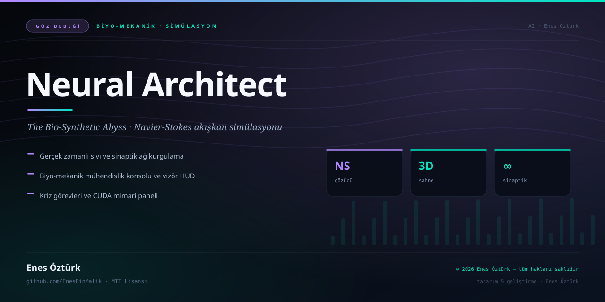
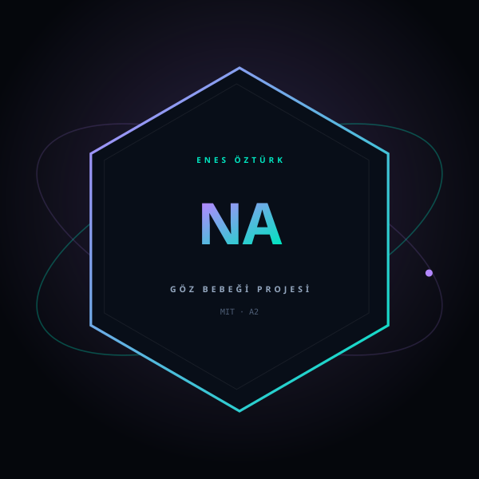

# Neural Architect: The Bio-Synthetic Abyss



<p align="center"></p>

<p align="center"><b>GÖZ BEBEĞİ PROJESİ</b> · BİYO-MEKANİK · SİMÜLASYON · 3D</p>

---

3D biyo-mekanik mühendislik: gerçek zamanlı Navier-Stokes akışkan simülasyonu ve sinaptik ağ kurgulama.

## Öne çıkanlar

- **Akışkan çözücü** — `src/simulation/EnesBioCore.ts` ile Navier-Stokes
- **Biyo sahne** — `src/three/BioScene.ts` ile organik 3D doku
- **Islak donanım konsolu** — `WetwareConsole` ile doku ve sıvı ayarları
- **Vizör HUD** — `VisorHUD` ile canlı telemetri
- **Kriz görevleri** — `CrisisMissionModal` ile acil müdahale
- **CUDA mimarisi** — `CudaArchitectureModal` ile donanım şeması

## Teknoloji

React · TypeScript · Three.js · Vite · Motion · Tailwind CSS

## Kurulum ve çalıştırma

```bash
npm install
npm run dev        # http://localhost:3000
```

| Komut | Ne yapar |
| --- | --- |
| `npm install` | bağımlılıkları kurar |
| `npm run dev` | geliştirme sunucusunu açar |
| `npm run build` | üretim derlemesi üretir |
| `npm run lint` | tip denetimi (`tsc --noEmit`) |

## Proje yapısı

```
neural-architect_-the-bio-synthetic-abyss/
├── index.html
├── package.json
├── vite.config.ts
├── docs/
│   ├── kapak.svg        # sinematik kapak
│   └── rozet.svg        # premium imza rozeti
└── src/
```

## Lisans ve telif

Bu proje **MIT Lisansı** ile yayınlanmıştır.

> © 2026 **Enes Öztürk** — tüm hakları saklıdır.
> Tasarım, kod ve görseller Enes Öztürk'e aittir. İzinsiz ticari kullanım yapılamaz.

[MIT Lisansı metni →](LICENSE)

---

<div align="center"><sub>
<a href="https://github.com/EnesBinMalik">github.com/EnesBinMalik</a> · 
imzalı bir <b>Enes Öztürk</b> projesi
</sub></div>
